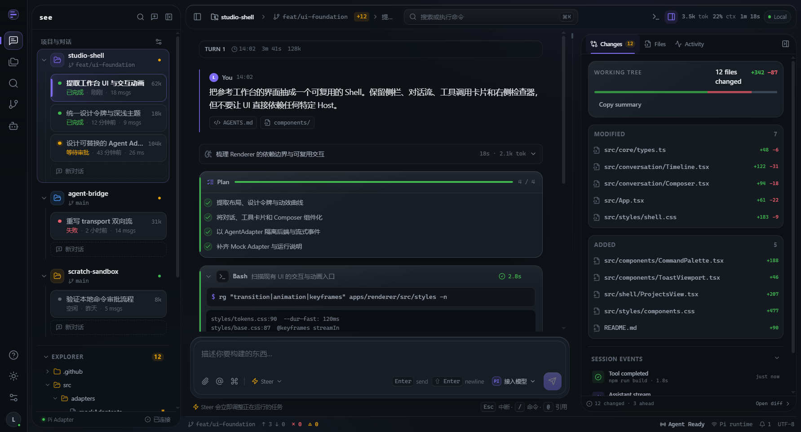
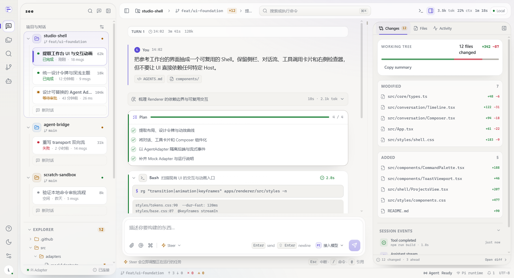

# see desktop updates

安装包、自动更新元数据和版本说明的公开分发仓库。



`see` 是一个本地优先的 Agent 工作台。当前默认接入 Pi 作为本地 Agent 内核，
并把对话、文件变更、工具调用、计划、审批、成本、审计和恢复状态放在同一个
桌面工作空间中。

## 下载

请从 [Releases](https://github.com/SgF-123/see-updates/releases/latest) 下载最新版本。

- **NSIS 安装包**：推荐，支持应用内自动更新；
- **portable**：免安装试用，不支持自动更新；
- 当前平台：Windows 10/11 x64。

安装包尚未配置 Authenticode 签名，Windows SmartScreen 可能显示“未知发布者”。
请在下载后核对 Release 正文中的 SHA-256。

## 当前版本

### v0.1.0

- 文档式 Agent 工作区与 Changes / Files / Activity 检查器；
- `Alt+Space` 全局快速捕获与 Windows 语音输入；
- 工具、命令、浏览器动作和远程审批的独立权限链；
- 中断检查点、任务收件箱和重启恢复；
- `pi-durable` 后台自动化与 Task Plan 恢复；
- 脱敏恢复遥测与设置页「Durable 恢复健康」卡片；
- 本地记忆账本、作品画布、能力地图、策略预演与 Code Mode；
- GitHub Releases 自动更新。

完整介绍与演示：

[see v0.1.0 发布说明](https://github.com/SgF-123/see-updates/releases/tag/v0.1.0)

浅色主题：



## 自动更新

桌面应用使用 electron-updater 从本仓库的 GitHub Releases 读取 stable 通道：

```text
https://github.com/SgF-123/see-updates/releases/latest
```

每个正式版本至少上传：

```text
see-<version>-x64.exe
see-<version>-x64.exe.blockmap
latest.yml
```

portable 可以随版本一起发布，但不参与自动更新。`latest.yml`、blockmap 和 NSIS
安装包必须来自同一次构建并属于同一个 Release。

## 发布通道

| 通道 | 用途 | GitHub Release |
| --- | --- | --- |
| stable | 日常使用 | 最新非预发布版本 |
| beta | 可选测试 | 标记为 pre-release |

稳定版本使用 `vMAJOR.MINOR.PATCH`。

## 隐私与仓库边界

本仓库不包含应用源码、签名密钥、访问 token 或用户数据。恢复遥测和诊断只保存在
用户本机；可导出的 Durable 诊断摘要不包含 prompt、模型输出、文件路径、runId
原文或原始错误正文。

Pi 内核、插件和模型目录使用官方 Pi 通道独立更新：

```text
pi update
pi update --extensions
pi update --models
```

Pi 运行时与 see 桌面端具有独立版本周期。升级 Pi 前必须通过 RPC handshake 和
兼容性检查。

## License

本仓库中的原创内容采用 [MIT License](LICENSE)：

```text
Copyright (c) 2026 SgF-123
```

应用内 Electron、Pi、字体、SDK 和其他第三方组件继续适用各自许可证。
